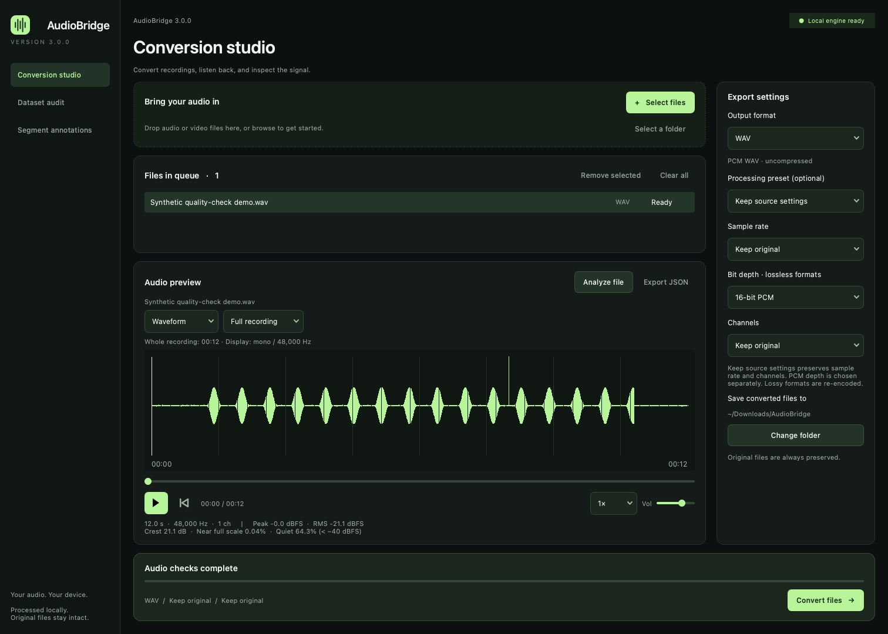
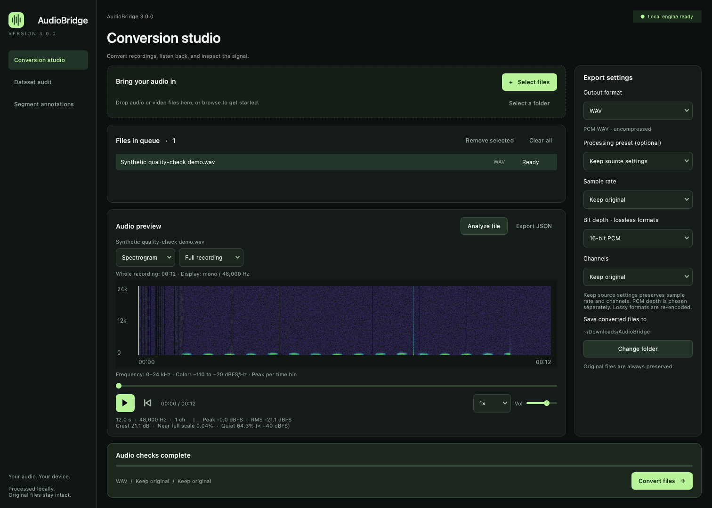

<p align="center"></p>

# AudioBridge · v3.0.0

I built AudioBridge to make audio preparation easier: convert recordings, listen back, inspect the signal, and keep track of files and segments before using them in an ASR or audio repair pipeline. Everything runs locally with Python, Qt, and FFmpeg.

[Download the v3.0.0 source release](https://github.com/Tabish-B/AudioBridge/releases/tag/v3.0.0) · [Changes](CHANGELOG.md)



The screenshots use a generated test signal, not a speech recording or an ML repair result.

## What changed in v3

- Separate output format and processing settings
- WAV, FLAC, MP3, AIFF, and supported original audio containers
- Full-recording waveform and spectrogram summaries, with zoom and horizontal scrolling
- A layout that stacks panels on smaller windows and scrolls vertically instead of squeezing controls together
- Dataset quality audits and manual segment annotations in their own workspaces
- A visible application version, Git tag, and GitHub release

## Run it

Use Python 3.9–3.12 and install FFmpeg, including FFprobe. On macOS, the Qt version used here requires macOS 12 or newer.

```bash
# macOS
brew install ffmpeg

# Ubuntu / Debian
sudo apt install ffmpeg
```

On Windows, install an FFmpeg build linked from [ffmpeg.org](https://ffmpeg.org/download.html) and add its `bin` directory to PATH.

```bash
python3 -m venv .venv
source .venv/bin/activate
# Windows: .venv\Scripts\activate
python -m pip install -r requirements.txt
python audio_converter.py
```

This is a source release: the GitHub release includes source archives, not a signed application installer. The desktop interface needs a display and an audio output device. Playback uses Qt's native AVFoundation backend on macOS and Qt's default media backend elsewhere. Codec availability depends on the installed media backend and FFmpeg build.

## Choose the output, then the processing settings

**Output format** means the file you want to write:

| Choice | Output | Notes |
| --- | --- | --- |
| WAV | PCM `.wav` | Uncompressed, 16-bit or 24-bit |
| FLAC | `.flac` | Lossless compression, 16-bit or 24-bit |
| MP3 | `.mp3` | Lossy encoding using LAME quality level 2; useful for smaller listening copies |
| AIFF | PCM `.aiff` | Uncompressed, 16-bit or 24-bit |
| Keep original | Source audio container | Supported for WAV, FLAC, MP3, M4A, AAC, AIFF/AIF, and Opus; re-encodes the audio |

For video sources or other audio containers, choose an explicit audio output format. OGG is supported as an input; this release doesn't offer Ogg Vorbis export because the tested FFmpeg build lacks that encoder.

**Processing preset** is optional and independent of output format:

- **Keep source settings** keeps the original sample rate and channel count. PCM depth is selected separately, with 16-bit as the default.
- **ASR input · 16 kHz mono** sets 16,000 Hz, one channel, and 16-bit PCM where applicable. ASR means automatic speech recognition; check your model's required input first.
- **Archive · 48 kHz / 24-bit** sets those sample rate and depth values and keeps the source channels. This is a convenience setting; resampling doesn't restore information lost in the source.
- Changing a setting yourself switches the preset to **Custom**.

Bit depth applies to lossless outputs, not MP3. A preserved container isn't a byte-for-byte copy: lossy files are re-encoded, so keep the source if you need an unchanged original.

Exports default to `Downloads/AudioBridge`. Source files stay intact; existing output filenames get a numbered suffix. Conversion settings are captured when the batch starts.

## Listen and inspect the whole recording

Add files, import a folder, or drag recordings onto the window. Folder import includes supported files directly inside that folder. Select a queue entry to prepare its full waveform and spectrogram in a background worker.

The default **Full recording** view includes the complete file. Choose a **30 s**, **2 min**, or **10 min** window to zoom in. A horizontal scrollbar appears when the recording is longer than that window. Scroll left or right to reach later audio, or enable **Follow playback** to move the visible window with the playhead. Click the plot to seek within the visible time range; the player timeline seeks through the entire file.

Play/pause, restart, speed, and volume controls are built in. Space toggles playback while you aren't entering text or editing a setting. Remove selected queue entries with **Remove selected**, Delete/Backspace, or **Clear all**.



The spectrogram shows time horizontally, frequency vertically, and power density by color. The display uses a mono downmix at the source rate up to 48 kHz, giving a maximum display frequency of 24 kHz. Recordings above 48 kHz are resampled for display only. Source analysis and exports use their own settings.

Previews are streamed in bounded chunks. The whole-file waveform has up to 12,000 envelope bins, and the spectrogram has up to 1,600 time bins. Spectrogram time bins use peak pooling, with a fixed −110 to −20 dBFS/Hz color scale. Zooming crops those summaries; it doesn't regenerate a sample-level view. Very long recordings therefore have coarser time detail. The display is an inspection aid, not a substitute for source-resolution spectral analysis. Preview decoding stops with an error if it exceeds a three-minute processing deadline.

## Audio checks and dataset audits

Click **Analyze file** in the preview panel for the selected file's measurements, then **Export JSON** to save them.

| Measurement | Calculation |
| --- | --- |
| Peak | Highest absolute sample value, in dBFS |
| RMS | Energy across all samples and channels, in dBFS |
| Crest factor | Peak level minus RMS level, in dB |
| Near full scale | Percentage of channel samples with absolute value ≥ 0.999 |
| Quiet audio | Percentage of time in 20 ms windows with RMS below −40 dBFS |

The **Dataset audit** workspace scans all queued recordings together and exports a CSV. Its fixed level flags are: near-full-scale samples above 0.01%, RMS below −35 dBFS, or quiet windows above 75%. A flag is a reason to inspect the recording, not a verdict about its usefulness.

Analysis scans the whole source in small blocks using SoundFile. If SoundFile cannot read a format, convert it to WAV first. A format can work in the player or preview even if source analysis can't decode it directly.

Quiet sections aren't voice activity detection. Samples near full scale can suggest clipping, but can't prove that earlier clipping occurred. Crest factor isn't the complete dynamic range. Digital silence uses a numerical floor of −240 dBFS. AudioBridge doesn't estimate true SNR, transcribe speech, or run an ML repair model.

## Segment annotations

In **Segment annotations**, mark a start and end from the current playhead, add a label, and export a CSV with file paths and times in seconds. Start playback or seek in the studio, then switch to the annotation workspace to mark your ranges. This can help review noise, overlap, or useful speech segments without editing the source.

Annotations are held in the current session; export them before closing. CSV exports are manual labels, not automatic speech segmentation. Smaller windows use a page selector in place of the sidebar.

## Test data and checks

```bash
python examples/make_demo.py /tmp/audiobridge-demo.wav
python audio_converter.py /tmp/audiobridge-demo.wav
python -m unittest discover -s tests -v
```

The demo generator creates a deterministic signal with quiet sections and a short full-scale segment. One or more real recordings can also be passed as command-line arguments. Run `python examples/capture_studio.py` to regenerate the studio and spectrogram screenshots with synthetic audio.

The regression suite covers conversion codecs, sample rate and channels, duplicate output names, player controls, background responsiveness, stale results, a tone after two minutes, spectrogram frequency content, zoom/scroll, small-window geometry, dataset audits, and annotations. Playback tests are muted and need a media backend. Validation was performed on macOS; Windows and Linux installers aren't supplied or validated in this release.

## Project layout

```text
AudioBridge/
├── audio_converter.py       # Desktop entry point
├── version.py               # App version
├── ui/studio.py             # Studio, player, audit, and annotations
├── ui/theme.qss             # Interface styling
├── converter/core.py        # FFmpeg conversion
├── converter/formats.py     # Output containers and codecs
├── converter/preview.py     # Whole-file display summaries
├── converter/analyzer.py    # Full-file measurements
├── converter/inspector.py   # FFprobe metadata
├── assets/                  # Logo and controls
├── docs/                    # GUI screenshots
├── examples/                # Test signal and screenshot generator
└── tests/
```

## License

The project code is licensed under MIT; see [LICENSE](LICENSE). Third-party libraries keep their own licenses. PySide6 uses Qt's [open-source and commercial licensing options](https://doc.qt.io/qtforpython-6/licenses.html). FFmpeg is installed separately; its license depends on the build. See [FFmpeg's license information](https://ffmpeg.org/legal.html).

Built by [Tabish Butt](https://github.com/Tabish-B). [Repository](https://github.com/Tabish-B/AudioBridge).
