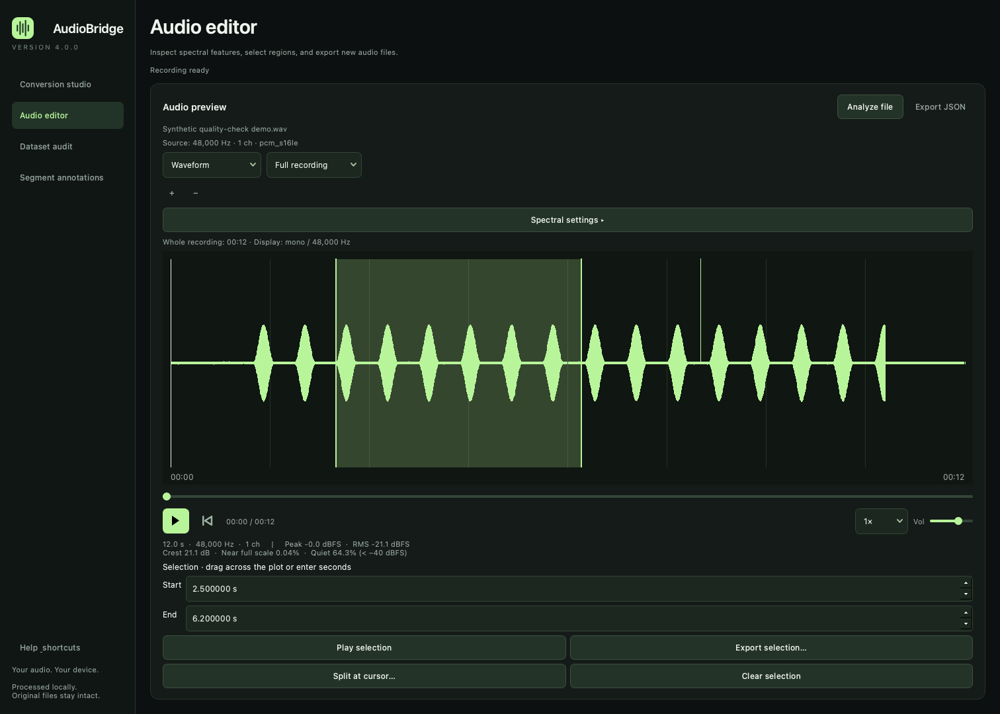
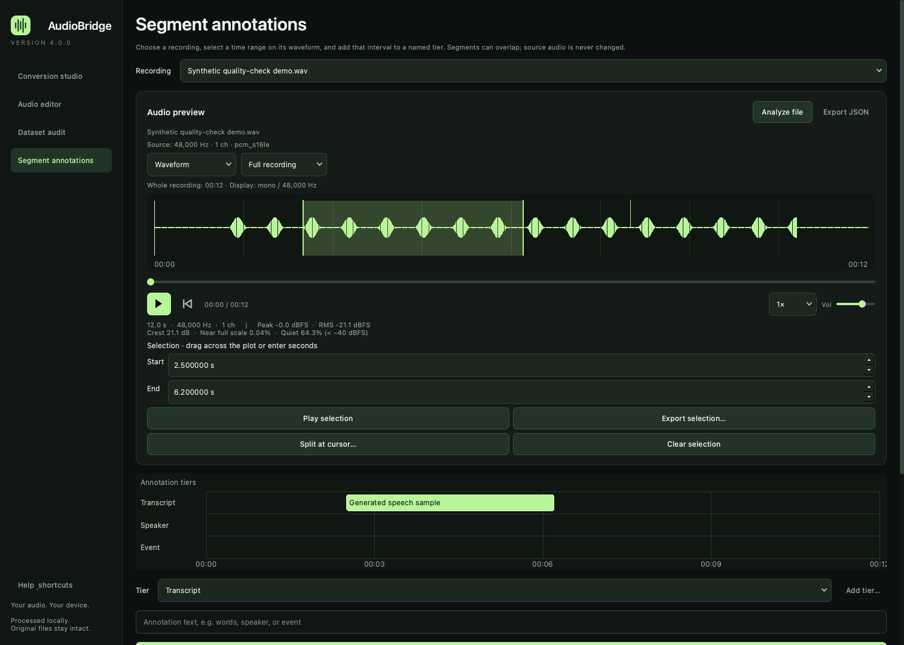

<p align="center"></p>

# AudioBridge

A local desktop workspace for preparing, inspecting, and editing research audio.
Built with Python, Qt, NumPy, SciPy, and FFmpeg.

**[V4 source release](https://github.com/Tabish-B/AudioBridge/releases/tag/v4.0.0)** · [User guide](docs/USER_GUIDE.md) · [Methods](docs/METHODS.md) · [Changelog](CHANGELOG.md)



## Explore, select, export

| Workspace | What you can do |
| --- | --- |
| **Audio editor** | Inspect waveforms, spectrograms, Mel spectrograms, and MFCCs. Configure FFT, hop, window, frequency, and dB ranges; export full-recording spectral images. |
| **Region editing** | Zoom, drag a selection, enter timestamps, listen to the selection, export a clip, or split at the cursor. |
| **Conversion studio** | Batch-export WAV, FLAC, MP3, AIFF, or a supported original container. |
| **Dataset tools** | Audit signal levels and create time-aligned, tiered annotations with JSON or CSV export. |

Source recordings stay intact. Processing runs locally; edits write new files.

## Time-aligned annotations

Create intervals from waveform selections, organize them into tiers, edit and replay them, then export an AudioBridge JSON file or CSV.



## Run locally

Install **Python 3.9–3.12** and **FFmpeg/FFprobe**, then:

```bash
python3 -m venv .venv
source .venv/bin/activate        # Windows: .venv\Scripts\activate
python -m pip install -r requirements.txt
python audio_converter.py
```

On macOS, install FFmpeg with `brew install ffmpeg`; on Ubuntu/Debian, use `sudo apt install ffmpeg`.
Windows builds are linked from [FFmpeg's download page](https://ffmpeg.org/download.html).

## Start with a recording

Add a file in **Conversion studio**, then open **Audio editor**. Drag across the plot to select audio, or type start/end seconds. Choose a spectral view, open **Spectral settings**, and apply your parameters.

[Editing and shortcuts →](docs/USER_GUIDE.md) · [Spectral definitions and limits →](docs/METHODS.md) · [Development and checks →](docs/DEVELOPMENT.md)

The screenshots use generated test audio. Whole-file feature views are time summaries; close-up waveform windows are decoded separately. AudioBridge does not run an ML repair or transcription model.

## License

[MIT](LICENSE). Qt/PySide6 and FFmpeg retain their own licenses. This is a source release; macOS is the validated platform and signed installers are not included.

Built by [Tabish Butt](https://github.com/Tabish-B).
